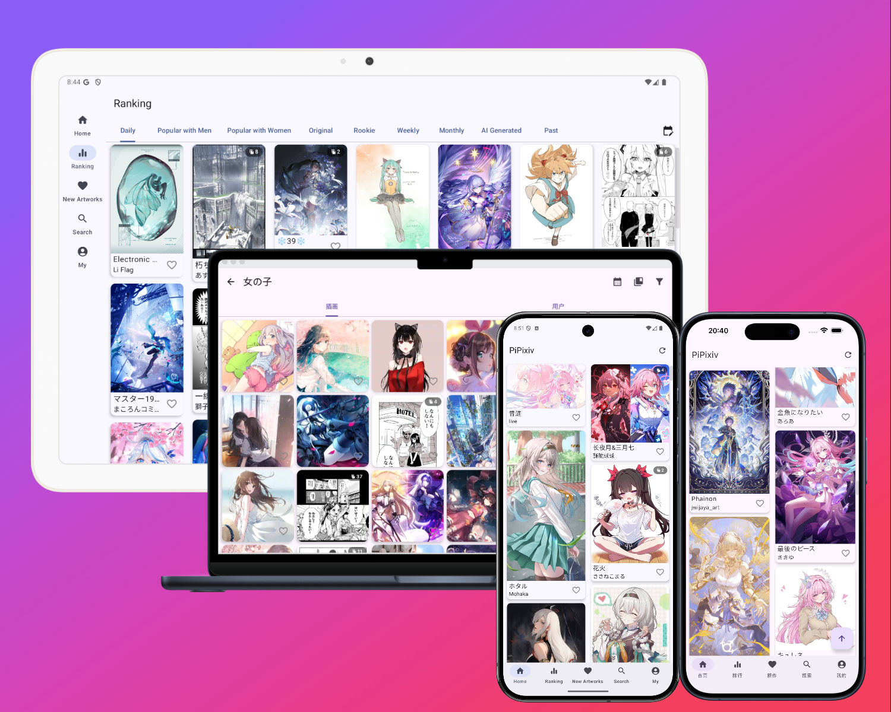

<div align="center">

[简体中文](./README.md) | [繁體中文](./README-zh-TW.md) | **English** | [日本語](./README-ja.md)

<a href="https://github.com/darriousliu/PiPixiv">
  
</a>

# PiPixiv

An open-source third-party Pixiv client built with Compose Multiplatform

**[Website](https://pipixiv.com/en)** &nbsp;·&nbsp; **[Installation](#download)** &nbsp;·&nbsp; **[Features](#features)** &nbsp;·&nbsp; **[Architecture](#architecture)**

[](#download)
[](#download)
[![Windows][windows-badge]](#download)
[](#download)
[](#download)

[](https://github.com/darriousliu/PiPixiv/releases/latest)
[](https://f-droid.org/packages/com.mrl.pixiv/)

[](https://github.com/darriousliu/PiPixiv/releases)
[](https://github.com/darriousliu/PiPixiv/actions/workflows/release.yml)
[](https://t.me/PiPixivChannel)

[](https://kotlinlang.org)
[](https://www.jetbrains.com/compose-multiplatform/)



</div>

[windows-badge]: https://img.shields.io/badge/Windows-24292F?style=flat-square&logo=data%3Aimage%2Fsvg%2Bxml%3Bbase64%2CPHN2ZyB4bWxucz0iaHR0cDovL3d3dy53My5vcmcvMjAwMC9zdmciIHZpZXdCb3g9IjAgMCAyNCAyNCI%2BPHBhdGggZmlsbD0iIzAwQTRFRiIgZD0iTTAgMGgxMS4zNzd2MTEuMzcySDB6bTEyLjYyMyAwSDI0djExLjM3MkgxMi42MjN6TTAgMTIuNjIzaDExLjM3N1YyNEgwem0xMi42MjMgMEgyNFYyNEgxMi42MjN6Ii8%2BPC9zdmc%2B

## Features

- 🎨 **Illustrations and manga**: Browse recommendations, rankings, followed artists' updates, and UGOIRA animations. Download originals individually or in batches and manage the download queue.
- 📖 **Novel reader**: Read in an immersive view with adjustable font size and line spacing. Reading progress is saved automatically, with series contents, Pixiv reading markers, and TXT export.
- 🤖 **AI translation**: Translate novels with OpenAI, Claude, Gemini, or compatible endpoints. Translations stream in and are cached locally.
- 👥 **Multiple accounts**: Sign in with OAuth or a web cookie and switch accounts instantly. Browsing history and reading progress are kept separately for each account.
- 🌐 **Network options**: Use the system proxy, a direct connection, or an HTTP / SOCKS proxy. Android and desktop also support ECH, and a built-in network check helps diagnose problems.
- 🖥️ **Every screen size**: Adaptive layouts for phones, tablets, and desktops, 13 interface languages, and keyboard shortcuts on desktop.

<details>
<summary><b>Full feature list</b></summary>

#### Accounts

- Sign in with a Pixiv account (OAuth) or with a web cookie (PHPSESSID), without entering a token manually.
- Add, switch, or remove accounts in **Settings → Switch accounts**. Browsing history, search history, Read Later, and novel reading progress are stored per account. Removing an account keeps its local data by default.
- Confirm before signing out.

#### Browsing

- Recommended illustrations on the home page in a waterfall layout.
- Latest updates, grouped into Discover, Bookmarks, and Following.
- Rankings: daily, weekly, monthly, male / female-oriented, AI-generated, and more.
- Switch between illustration and novel views on Home, Feed, Collection, Ranking, and Search. Your choice is remembered.
- Local illustration and novel history with search, clearing, and automatic cleanup. Pixiv Premium users can enable cloud history.

#### Illustrations

- Artwork details, including multi-page works, UGOIRA animations, and related artworks.
- Choose the preview image quality, zoom in, and browse related artworks at their original aspect ratios.
- Download originals or animated GIFs with custom filenames and a managed download queue. For multi-image works, download the selected images or all of them.

#### Novels

- Immersive reading with adjustable font size and line spacing and a draggable scrollbar. Your position is kept when you change the layout.
- See the full title, tags, synopsis, publication date, and statistics. While reading, view series information and jump to the author's profile or the series contents.
- Open and zoom in on images embedded in a novel.
- Continue a series from its contents page, which shows the last-read chapter and progress percentage.
- Reading progress is saved and restored automatically. Supports Pixiv novel reading markers and TXT export.

#### AI translation

- Works with OpenAI, Claude, Gemini, and compatible endpoints, including services on your local network. Configure the model, timeout, and request parameters.
- Fetch the list of available models, limit global concurrency, and translate the text, title, and synopsis.
- Translations stream in, are cached locally, and can be toggled with the original text.
- Read Later translation queue: check task status, retry failed tasks, and regenerate translations.

#### Search

- Search illustrations, novels, and users, sorted by popularity, date, and more.
- Set the default matching mode, sorting, and AI content filter. Illustration and novel searches each remember their last sorting and filters across restarts.
- Show results as a continuous scroll or in pages, with previous / next and jump-to-page controls where supported.
- Illustration results can use square thumbnails or an original-aspect-ratio waterfall layout. Novel results use a wider list with compact titles.
- Long-press a tag to bookmark it or copy it to the clipboard.

#### Users and bookmarks

- View an author's bio, profile, workspace, illustration / manga / novel submissions, and public bookmarks. Tap the avatar to enlarge it, or a novel preview to start reading.
- View following lists, with public and private tabs for your own follows.
- Read and post comments.
- Bookmark illustrations and novels, follow or unfollow authors, and filter bookmarks by tag.

#### Network and privacy

- Use the system proxy by default, or switch to a direct connection or a manual HTTP / SOCKS proxy. New requests use the saved setting immediately. Android and desktop also offer an ECH mode. The connection modes available for web sign-in vary by platform.
- Set a custom App API proxy domain in **Network settings**, and run a **Network check** for DNS, the Pixiv API, the Pixiv website, sign-in, and image downloads.
- Choose whether R-18 content is shown and whether the clipboard is read when you open Search. Android Default, iOS, and desktop users can turn off anonymous usage statistics.
- Block artworks, users, and tags, and filter long novel tags by length and segment count.

#### Settings and data

- General settings: language, image source, grid columns, private bookmarks, and more. The bottom navigation can be a floating liquid-glass bar or a standard bar.
- Deep link support.
- Clear the cache and import or export backups in **App data**. If any items are pending after an upgrade, retry them one by one in **Data recovery**, or import and export legacy data packages.
- View logs from the current and previous runs in **Settings → About → App logs**, filter them by level, and copy or share them.
- Update dialogs show release notes as Markdown. Open the Telegram updates channel from **Settings → About**.

#### Desktop

- Follow the system light / dark theme, or choose one manually.
- Press `R` in a list to scroll to the top or refresh, use the arrow keys to scroll, and press `Esc` to go back.

</details>

## Download

Current source version: **2.7.0**. Installers for every platform are on [GitHub Releases](https://github.com/darriousliu/PiPixiv/releases/latest).

| Platform | Requirement | Package |
| --- | --- | --- |
| Android | Android 8.0 or later | APK (Default / FOSS), also on [F-Droid](https://f-droid.org/packages/com.mrl.pixiv/) |
| iOS | iOS 18 or later | Unsigned IPA; sign it yourself before installing |
| Windows | x86_64 | MSI |
| macOS | Apple Silicon (arm64) | DMG |
| Linux | x86_64 | tar.gz |

Android comes in two variants:

- **Default** includes Firebase and Sentry for crash reporting and anonymous usage statistics. Anonymous statistics can be turned off in Settings.
- **FOSS** contains no analytics or crash-reporting dependencies. This is the variant published on F-Droid.

Release announcements are posted to the Telegram channel [@PiPixivChannel](https://t.me/PiPixivChannel).

## Architecture

PiPixiv is built with Kotlin Multiplatform. The UI, business logic, networking, and storage all live in shared code, and each platform keeps only a thin entry layer. Shared code is compiled for Android, iOS (arm64 devices and simulators), and the JVM desktop.

### Modules

```text
         app                 desktopApp            iosApp + iosExport
      (Android)       (Windows / macOS / Linux)    (iOS, Swift Export)
          |                       |                         |
          +-----------------------+-------------------------+
                                  |
                                  v
                             composeApp
                                  |
                                  v
                              feature/*
                                  |
              +-------------------+
              |                   |
              v                   v
          common/ui ----> common/repository
                                  |
                                  v
      +-------------------------------------------------------+
      |  datasource-remote   datasource-local   network   ai  |
      +-------------------------------------------------------+
                                  |
                                  v
                      common/core   common/data
```

The diagram shows the main dependency directions by layer. Arrows point to the module being depended on.

| Module | Responsibility |
| --- | --- |
| `app` | Android entry point: Default / FOSS builds, signing, and the Baseline Profile |
| `desktopApp` | Desktop entry point, packaged as MSI, DMG, and tar.gz with Nucleus |
| `iosApp`, `iosExport` | Xcode project; `iosExport` uses Swift Export to expose shared code to Swift as `PiPixivKit` |
| `composeApp` | Shared app shell that assembles the feature modules, navigation, and dependency injection |
| `feature/*` | Screens split by feature, such as `picture`, `novel`, `manga`, `collection`, and `setting` |
| `common/ui` | Theme, shared components, and paging states |
| `common/repository` | Repository layer combining the remote API, local database, networking, and AI translation |
| `common/datasource-remote` | Pixiv API definitions built with Ktorfit |
| `common/datasource-local` | Local database built with Room 3 |
| `common/network` | Ktor client, proxy support, and ECH |
| `common/ai` | Translation providers such as OpenAI, Claude, and Gemini |
| `common/core` | Key-value storage, logging, routing, coroutines, ViewModel base classes, and other foundations |
| `common/data` | Data models and user preferences |
| `common/analytics-default`, `common/analytics-foss` | Two implementations of analytics and crash reporting; the build variant picks one |
| `common/platform-api` | Interfaces implemented natively, such as saving to Photos and ZIP handling on iOS in Swift |
| `common/icons` | Icons |
| `lib_strings` | String resources for 13 languages |

### Tech stack

| Area | Choice |
| --- | --- |
| UI | Compose Multiplatform, Material 3 adaptive layouts |
| Navigation | Navigation 3 |
| Dependency injection | Koin, Koin Annotations (KSP) |
| Networking | Ktor and Ktorfit; OkHttp engine on Android and desktop, Darwin engine on iOS |
| ECH | ECH configs fetched over DoH, connections made with Conscrypt (Android and desktop) |
| Storage | Room 3 (bundled SQLite), MMKV ([mmkv-kotlin](https://github.com/darriousliu/mmkv-kotlin)) |
| Images | Coil 3, ZoomImage |
| Foundations | Kotlin Coroutines / Flow, kotlinx.serialization, Kermit, FileKit |
| Monitoring | Firebase Crashlytics / Analytics and Sentry (Default builds only) |
| Desktop | Nucleus for windowing, WebView, and installer packaging, with an optional JVM AOT cache |
| iOS | Swift Export exposes Kotlin modules; platform features are implemented in Swift |

### Engineering

- **Convention plugins**: `pixiv.multiplatform`, `pixiv.multiplatform.compose`, `pixiv.android.application`, and `pixiv.desktop.compose` in `build-logic` keep module build configuration consistent.
- **Dependencies**: Versions live in [`gradle/libs.versions.toml`](./gradle/libs.versions.toml), and Renovate opens upgrade PRs automatically. FOSS builds check the dependency graph to make sure no analytics dependencies slip in.
- **CI**: Every push to `develop` builds all platforms. Pushing a version tag builds six packages (Android Default / FOSS, iOS, Windows, macOS, Linux) and collects them in a release. Localization consistency and Fastlane metadata are checked as well.
- **Performance and tooling**: A Baseline Profile speeds up Android startup. During development, desktop supports Compose Hot Reload and Android supports HotSwan hot reload.

## Building locally

Requirements:

- JDK 25 (Gradle downloads the toolchain through Foojay if it is missing)
- An Android Studio release that supports Android Gradle Plugin 9.5
- macOS and Xcode to build for iOS

For local builds, pass `-PapplyFirebasePlugins=false` to build the FOSS variant, so you don't need the Firebase and Sentry configuration files:

```bash
# Android
./gradlew :app:assembleDebug -PapplyFirebasePlugins=false

# Desktop
./gradlew :desktopApp:run -PapplyFirebasePlugins=false
```

For iOS, open `iosApp/PiPixiv.xcodeproj` in Xcode and run it from there.

The app version is maintained in [`gradle.properties`](./gradle.properties) and the [iOS configuration](./iosApp/Configuration/Config.xcconfig).

## Contributing

Issues and pull requests are welcome. Conventions for code style, commit messages, localization, and UI checks are in [AGENTS.md](./AGENTS.md).

## Star history

<a href="https://www.star-history.com/?repos=darriousliu%2FPiPixiv&amp;type=date">
  <picture>
    <source media="(prefers-color-scheme: dark)" srcset="https://api.star-history.com/svg?repos=darriousliu/PiPixiv&amp;type=Date&amp;theme=dark" />
    <source media="(prefers-color-scheme: light)" srcset="https://api.star-history.com/svg?repos=darriousliu/PiPixiv&amp;type=Date" />
    
  </picture>
</a>

## Acknowledgments

This project uses or draws on these open-source projects:

- [Coil](https://github.com/coil-kt/coil): A cross-platform image loading library powered by Kotlin Coroutines
- [Koin](https://github.com/InsertKoinIO/koin): A pragmatic, lightweight dependency injection framework for Kotlin
- [Multiplatform Markdown Renderer](https://github.com/mikepenz/multiplatform-markdown-renderer): Markdown rendering for Compose Multiplatform
- [Mihon](https://github.com/mihonapp/mihon): Reference for in-app language switching
- [pixez-flutter](https://github.com/Notsfsssf/pixez-flutter): Reference for the sign-in implementation
- [Pixiv-MultiPlatform](https://github.com/magic-cucumber/Pixiv-MultiPlatform): Reference for desktop scrolling shortcuts

## License

PiPixiv is licensed under [Apache-2.0](./LICENSE).
