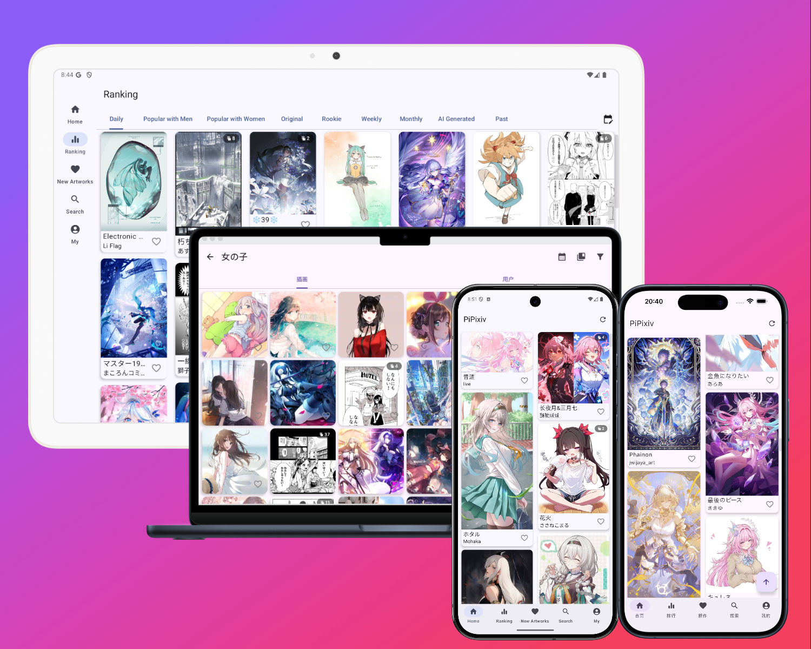

<div align="center">

[简体中文](./README.md) | [繁體中文](./README-zh-TW.md) | [English](./README-en.md) | **日本語**

<a href="https://github.com/darriousliu/PiPixiv">
  
</a>

# PiPixiv

Compose Multiplatform で開発したオープンソースの非公式 pixiv クライアント

**[公式サイト（英語）](https://pipixiv.com/en)** &nbsp;·&nbsp; **[インストール方法](#ダウンロード)** &nbsp;·&nbsp; **[機能](#機能)** &nbsp;·&nbsp; **[アーキテクチャ](#アーキテクチャ)**

[](#ダウンロード)
[](#ダウンロード)
[![Windows][windows-badge]](#ダウンロード)
[](#ダウンロード)
[](#ダウンロード)

[](https://github.com/darriousliu/PiPixiv/releases/latest)
[](https://f-droid.org/packages/com.mrl.pixiv/)

[](https://github.com/darriousliu/PiPixiv/releases)
[](https://github.com/darriousliu/PiPixiv/actions/workflows/release.yml)
[](https://t.me/PiPixivChannel)

[](https://kotlinlang.org)
[](https://www.jetbrains.com/compose-multiplatform/)



</div>

[windows-badge]: https://img.shields.io/badge/Windows-24292F?style=flat-square&logo=data%3Aimage%2Fsvg%2Bxml%3Bbase64%2CPHN2ZyB4bWxucz0iaHR0cDovL3d3dy53My5vcmcvMjAwMC9zdmciIHZpZXdCb3g9IjAgMCAyNCAyNCI%2BPHBhdGggZmlsbD0iIzAwQTRFRiIgZD0iTTAgMGgxMS4zNzd2MTEuMzcySDB6bTEyLjYyMyAwSDI0djExLjM3MkgxMi42MjN6TTAgMTIuNjIzaDExLjM3N1YyNEgwem0xMi42MjMgMEgyNFYyNEgxMi42MjN6Ii8%2BPC9zdmc%2B

## 機能

- 🎨 **イラスト・マンガ**　ホームのおすすめ、ランキング、フォロー中の新着作品、うごイラを閲覧できます。原寸画像の保存や一括ダウンロード、ダウンロードキューの管理にも対応しています。
- 📖 **小説リーダー**　文字サイズと行間を調整でき、読んだ位置を自動で記録します。シリーズの目次、pixiv のしおり、テキストファイルへの書き出しも利用できます。
- 🤖 **AI 翻訳**　OpenAI、Claude、Gemini や互換 API を使って小説を翻訳します。訳文は生成とともに表示され、端末に保存されます。
- 👥 **複数アカウント**　OAuth またはブラウザーの Cookie でログインでき、アカウントをすぐに切り替えられます。閲覧履歴や小説の読書位置はアカウントごとに保存されます。
- 🌐 **ネットワーク設定**　システムのプロキシ、直接接続、HTTP / SOCKS プロキシを選べます。接続の診断機能を備え、Android 版とデスクトップ版は ECH にも対応しています。
- 🖥️ **画面サイズに合わせた表示**　スマートフォン、タブレット、デスクトップに合わせてレイアウトが切り替わります。表示言語は 13 言語から選べ、デスクトップではキーボードショートカットも使えます。

<details>
<summary><b>機能一覧を開く</b></summary>

#### アカウント

- pixiv アカウントを使う OAuth ログインと、ブラウザーの Cookie（PHPSESSID）を使うログインに対応しています。トークンを手入力する必要はありません。
- 「設定 → アカウントを切り替える」でアカウントの追加、切り替え、削除ができます。閲覧履歴、検索履歴、「あとで読む」、小説の読書位置はアカウントごとに保存されます。アカウントを削除しても、既定ではそのアカウントのローカルデータが残ります。
- ログアウトする前に確認画面が表示されます。

#### 作品を探す

- ホームでは、おすすめのイラストを画像の高さに合わせてタイル状に表示します。
- 新着情報を「トレンド」「コレクション」「フォロー中」のタブで確認できます。
- デイリー、ウィークリー、マンスリー、男性に人気、女性に人気、AI 生成などのランキングを閲覧できます。
- ホーム、新着、ブックマーク、ランキング、検索の各画面でイラストと小説を切り替えられます。表示の選択は次回も引き継がれます。
- 端末に保存したイラストや小説の閲覧履歴を検索、一括削除、自動整理できます。pixiv プレミアム会員はクラウドの閲覧履歴も利用できます。

#### イラスト

- 作品の詳細画面では、複数枚の画像やうごイラ、関連するおすすめ作品を閲覧できます。
- 画像のプレビューでは画質の切り替えやズームができます。関連作品は元の縦横比で表示できます。
- 原寸画像や GIF 形式のうごイラをダウンロードできます。ファイル名の変更やダウンロードキューの管理に対応し、複数枚の作品では保存したい画像だけ、または全画像をまとめて選べます。

#### 小説

- 本文に集中できるリーダーで、文字サイズや行間を調整できます。スクロールバーをドラッグして読みたい箇所に移動でき、文字組みを変更しても読んでいた位置が保たれます。
- タイトル全文、タグ、あらすじ、投稿日時、統計を表示します。読書中にシリーズ情報を確認したり、作者のプロフィールやシリーズの目次を開いたりできます。
- 本文中の挿絵はアプリ内で拡大して表示できます。
- シリーズの目次で前回読んだ話と進捗率を確認し、続きから読み始められます。
- 読書位置を自動で保存・復元します。pixiv の小説のしおりや TXT 形式での書き出しにも対応しています。

#### AI 翻訳

- OpenAI、Claude、Gemini および互換 API に対応しています。LAN 内のサービスにも接続でき、モデル、タイムアウト、リクエストパラメーターを指定できます。
- 利用できるモデルの一覧を取得し、アプリ全体の同時リクエスト数を制限できます。翻訳の対象は本文、タイトル、あらすじです。
- 訳文は生成された部分から順に表示され、端末にキャッシュされます。原文と訳文はいつでも切り替えられます。
- 「あとで読む」の翻訳キューでは、進行状況の確認、失敗した翻訳の再試行、訳文の再生成ができます。

#### 検索

- イラスト、小説、ユーザーを検索し、人気順や新着順などで並べ替えられます。
- 既定の検索方法、並べ替え順、AI 作品の表示条件を設定できます。最後に使った並べ替え順と絞り込み条件はイラストと小説で別々に保存され、アプリを再起動しても引き継がれます。
- 検索結果は連続スクロールとページ送りから選べます。ページ送りでは前後のページや指定したページに移動できます。
- イラストの検索結果は正方形のグリッドと、元の縦横比を保ったタイル表示から選べます。小説は横幅を広く取り、タイトルをコンパクトに表示します。
- タグを長押しすると、お気に入りへの追加やクリップボードへのコピーができます。

#### ユーザーとブックマーク

- 作者の自己紹介、プロフィール、作業環境、投稿したイラスト・マンガ・小説、公開ブックマークを閲覧できます。プロフィール画像はタップで拡大でき、小説のプレビューをタップすると本文が開きます。
- フォロー一覧を閲覧できます。自分のフォロー一覧では公開と非公開を切り替えられます。
- コメントの閲覧と投稿ができます。
- イラストや小説のブックマーク、作者のフォローと解除、タグによるブックマークの絞り込みに対応しています。

#### ネットワークとプライバシー

- 既定ではシステムのプロキシを使用します。直接接続や手動の HTTP / SOCKS プロキシにも切り替えられ、保存後のリクエストから設定が反映されます。Android 版とデスクトップ版では ECH モードも選べます。ウェブログインで利用できる接続方法はプラットフォームによって異なります。
- 「ネットワーク設定」で App API プロキシのドメインを指定できます。「ネットワーク診断」では、DNS の名前解決、pixiv API、公式サイト、ログイン先への接続、画像のダウンロードを確認できます。
- R-18 作品の表示や、検索画面を開いたときにクリップボードを読み取るかどうかを設定できます。Android の Default 版、iOS 版、デスクトップ版では匿名の利用統計を無効にできます。
- 作品、ユーザー、タグをブロックできます。小説の長いタグは文字数や区切りの数で除外できます。

#### 設定とデータ

- 表示言語、画像の取得元、グリッドの列数、非公開ブックマークなどを設定できます。下部ナビゲーションはフローティング表示のリキッドガラスと標準スタイルから選べます。
- ディープリンクに対応しています。
- 「アプリデータ」ではキャッシュの削除、バックアップの読み込みと書き出しができます。更新後に復元待ちの項目があれば、「データの復元」で項目ごとに再試行できます。旧形式のデータの読み込みと書き出しにも対応しています。
- 「設定 → について → アプリのログ」で今回と前回の起動時のログを確認できます。ログレベルによる絞り込み、コピー、共有ができます。
- 更新ダイアログには Markdown 形式のリリースノートを表示します。「設定 → について」から Telegram の更新情報チャンネルを開けます。

#### デスクトップ

- ライトテーマとダークテーマはシステム設定に連動し、手動でも選べます。
- リストでは `R` キーで先頭への移動や再読み込み、矢印キーでスクロール、`Esc` キーで前の画面に戻る操作ができます。

</details>

## ダウンロード

現在のソースコードのバージョンは **2.7.0** です。各プラットフォームの配布ファイルは [GitHub Releases](https://github.com/darriousliu/PiPixiv/releases/latest) からダウンロードできます。

| プラットフォーム | 動作環境 | 配布形式 |
| --- | --- | --- |
| Android | Android 8.0 以降 | APK（Default / FOSS）。[F-Droid](https://f-droid.org/packages/com.mrl.pixiv/) からもインストールできます |
| iOS | iOS 18 以降 | 未署名の IPA。インストール前に各自で署名が必要です |
| Windows | x86_64 | MSI |
| macOS | Apple Silicon（arm64） | DMG |
| Linux | x86_64 | tar.gz |

Android 版は 2 種類あります。

- **Default** は Firebase と Sentry を使ってクラッシュを報告し、匿名の利用統計を収集します。匿名の利用統計は設定で無効にできます。
- **FOSS** には利用統計やクラッシュ報告のライブラリを含みません。F-Droid ではこちらを配布しています。

リリース情報は Telegram チャンネル [@PiPixivChannel](https://t.me/PiPixivChannel) でもお知らせしています。

## アーキテクチャ

PiPixiv は Kotlin Multiplatform で構築しています。UI、ビジネスロジック、通信、ストレージを共有コードにまとめ、プラットフォーム別のエントリーポイントは最小限に抑えています。共有コードのコンパイル先は Android、iOS（arm64 実機・シミュレーター）、デスクトップ JVM の 3 系統です。

### モジュール構成

```text
         app                 desktopApp            iosApp + iosExport
      (Android)       (Windows / macOS / Linux)    (iOS, Swift Export)
          |                       |                         |
          +-----------------------+-------------------------+
                                  |
                                  v
                             composeApp
                                  |
                                  v
                              feature/*
                                  |
              +-------------------+
              |                   |
              v                   v
          common/ui ----> common/repository
                                  |
                                  v
      +-------------------------------------------------------+
      |  datasource-remote   datasource-local   network   ai  |
      +-------------------------------------------------------+
                                  |
                                  v
                      common/core   common/data
```

主な依存関係を層ごとに示しています。矢印の先が依存先のモジュールです。

| モジュール | 役割 |
| --- | --- |
| `app` | Android アプリのエントリーポイント。Default / FOSS のビルド、署名、Baseline Profile を管理 |
| `desktopApp` | デスクトップアプリのエントリーポイント。Nucleus を使って MSI、DMG、tar.gz を作成 |
| `iosApp`、`iosExport` | iOS の Xcode プロジェクトと Swift 連携。`iosExport` は Swift Export を使い、共有コードを Swift から呼び出せる `PiPixivKit` として公開 |
| `composeApp` | 機能モジュールをまとめ、ナビゲーションと依存性注入を構成する共有アプリケーション層 |
| `feature/*` | `picture`、`novel`、`manga`、`collection`、`setting` など、機能別の画面 |
| `common/ui` | テーマ、共通 UI コンポーネント、ページングの状態など |
| `common/repository` | リモート API、ローカルデータベース、通信、AI 翻訳をまとめるリポジトリ層 |
| `common/datasource-remote` | Ktorfit による pixiv API の定義 |
| `common/datasource-local` | Room 3 を使ったローカルデータベース |
| `common/network` | Ktor クライアント、プロキシ、ECH |
| `common/ai` | OpenAI、Claude、Gemini などの翻訳サービスとの連携 |
| `common/core` | キーバリューストア、ログ、ルーティング、コルーチン、ViewModel などの共通機能 |
| `common/data` | データモデルとユーザー設定 |
| `common/analytics-default`、`common/analytics-foss` | 利用統計とクラッシュ報告に関する 2 つの実装。ビルドの種類に応じて一方を選択 |
| `common/platform-api` | ネイティブ実装を必要とするプラットフォーム API。iOS の写真ライブラリへの保存や ZIP 処理は Swift で実装 |
| `common/icons` | アイコン |
| `lib_strings` | 13 言語の文字列リソース |

### 技術スタック

| 分野 | 採用技術 |
| --- | --- |
| UI | Compose Multiplatform、Material 3 のアダプティブレイアウト |
| ナビゲーション | Navigation 3 |
| 依存性注入 | Koin、Koin Annotations（KSP） |
| 通信 | Ktor、Ktorfit。Android とデスクトップでは OkHttp エンジン、iOS では Darwin エンジンを使用 |
| ECH | DoH で ECH の設定を取得し、Conscrypt で接続（Android・デスクトップ） |
| ストレージ | Room 3（SQLite 同梱）、MMKV（[mmkv-kotlin](https://github.com/darriousliu/mmkv-kotlin)） |
| 画像 | Coil 3、ZoomImage |
| 基盤ライブラリ | Kotlin Coroutines / Flow、kotlinx.serialization、Kermit、FileKit |
| モニタリング | Firebase Crashlytics / Analytics、Sentry（Default ビルドのみ） |
| デスクトップ | ウィンドウ、WebView、インストーラーの作成に Nucleus を使用。JVM AOT キャッシュは任意で利用可能 |
| iOS | Swift Export で Kotlin モジュールを公開し、プラットフォーム固有の機能を Swift で実装 |

### ビルドと開発環境

- **規約プラグイン**　`build-logic` の `pixiv.multiplatform`、`pixiv.multiplatform.compose`、`pixiv.android.application`、`pixiv.desktop.compose` で各モジュールのビルド設定を共通化しています。
- **依存関係の管理**　バージョンは [`gradle/libs.versions.toml`](./gradle/libs.versions.toml) にまとめ、Renovate が更新を提案します。FOSS ビルドでは依存関係グラフを検査し、利用統計用ライブラリが含まれていないことを確認します。
- **継続的インテグレーション**　`develop` へのプッシュごとに全プラットフォームをビルドします。バージョンタグをプッシュすると 6 種類の配布ファイル（Android Default / FOSS、iOS、Windows、macOS、Linux）をビルドし、GitHub Releases にまとめます。翻訳リソースの整合性と Fastlane メタデータも検証します。
- **パフォーマンスと開発ツール**　Android では Baseline Profile で起動を高速化しています。開発中はデスクトップで Compose Hot Reload、Android で HotSwan のホットリロードが使えます。

## ローカルでのビルド

必要な開発環境は次のとおりです。

- JDK 25（未インストールの場合は Gradle が Foojay 経由でツールチェーンを自動取得します）
- Android Gradle Plugin 9.5 に対応する Android Studio
- iOS をビルドする場合は macOS と Xcode

ローカルでは `-PapplyFirebasePlugins=false` を付けて FOSS 版をビルドすると、Firebase や Sentry の設定ファイルを用意せずに実行できます。

```bash
# Android
./gradlew :app:assembleDebug -PapplyFirebasePlugins=false

# デスクトップ
./gradlew :desktopApp:run -PapplyFirebasePlugins=false
```

iOS では Xcode で `iosApp/PiPixiv.xcodeproj` を開いて実行してください。

アプリのバージョンは [`gradle.properties`](./gradle.properties) と [iOS の設定ファイル](./iosApp/Configuration/Config.xcconfig) で管理しています。

## コントリビュート

Issue やプルリクエストを歓迎します。コードスタイル、コミットメッセージ、翻訳の同期、UI の検証については [AGENTS.md](./AGENTS.md) をご覧ください。

## GitHub スター数の推移

<a href="https://www.star-history.com/?repos=darriousliu%2FPiPixiv&amp;type=date">
  <picture>
    <source media="(prefers-color-scheme: dark)" srcset="https://api.star-history.com/svg?repos=darriousliu/PiPixiv&amp;type=Date&amp;theme=dark" />
    <source media="(prefers-color-scheme: light)" srcset="https://api.star-history.com/svg?repos=darriousliu/PiPixiv&amp;type=Date" />
    
  </picture>
</a>

## 謝辞

本プロジェクトでは、次のオープンソースプロジェクトを利用し、その実装を参考にしています。

- [Coil](https://github.com/coil-kt/coil) は Kotlin Coroutines を使ったクロスプラットフォームの画像読み込みライブラリです。
- [Koin](https://github.com/InsertKoinIO/koin) は Kotlin 向けの軽量な依存性注入フレームワークです。
- [Multiplatform Markdown Renderer](https://github.com/mikepenz/multiplatform-markdown-renderer) は Compose Multiplatform 向けの Markdown 描画コンポーネントです。
- [Mihon](https://github.com/mihonapp/mihon) のアプリ内での言語切り替えの実装を参考にしました。
- [pixez-flutter](https://github.com/Notsfsssf/pixez-flutter) のログインの実装を参考にしました。
- [Pixiv-MultiPlatform](https://github.com/magic-cucumber/Pixiv-MultiPlatform) のデスクトップ向けスクロールショートカットの実装を参考にしました。

## ライセンス

本プロジェクトは [Apache-2.0](./LICENSE) ライセンスで公開しています。
